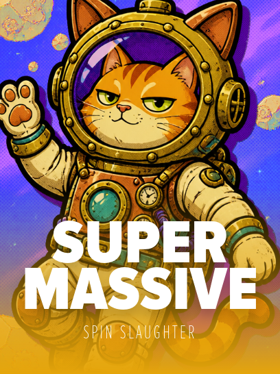

<div align="center">

# Super Massive



**A 5×4 cluster-tumble slot from [Spin Slaughter](https://stake.us/casino/games/spinslaughter-super-massive).**
*Every cascade feeds the black hole.*

### ▶ Play now on Stake

**[stake.us — Super Massive](https://stake.us/casino/games/spinslaughter-super-massive)**

Also live across Stake's platforms — **stake.com · stake.us · stake.eu · stake.mx · staked.com**
(global slug: `spinslaughter-super-massive`)

</div>

---

## About

**Super Massive** is a cosmic **5×4 orthogonal cluster-tumble** slot. Winning symbols are pulled into a layout-reactive **black hole**, and the **Gravity Multiplier** climbs through every cascade — then **persists through Free Spins**, so a hot run keeps its pull. This build is the version **approved by Stake**.

It's a **social-casino** title — play is in Stake Cash / Gold Coins (`SC` / `GC`), no real-money wagering.

## Game facts

| | |
|---|---|
| **Grid** | 5×4, orthogonal cluster tumble |
| **Core mechanic** | Cascades pull symbols into the black hole; **Gravity Multiplier** climbs and carries into Free Spins |
| **RTP** | 96.5% (every mode) |
| **Bet modes** | 6 — see below |
| **Currency** | Social — `SC` / `GC` |
| **Studio** | Spin Slaughter |

### Modes

| Mode | Cost | Feature |
|---|---|---|
| **Base** | 1× | Cluster tumble + Gravity Multiplier |
| **Dark Matter** (ante) | 1.25× | Boosted free-spin trigger rate |
| **Three-Wild Shot** | 1.70× | Opens with 3 server-scored Wilds that **persist** until disarmed |
| **Event Horizon** (bonus) | 120× | 12 Free Spins |
| **Ejecta Reactor** | 225× | 15 FS opening with 3 Wilds; clusters charge in more Wilds |
| **Singularity** (super) | 400× | 15 FS from a x12 ladder step — the package ceiling |

## Tech

**Frontend** — [PixiJS v8](https://pixijs.com) + Svelte on the Stake Engine `web-sdk`; XState round machine, Howler audio.

**Math** — Python engine (Stake Engine `math-sdk` lineage): six production pools at 96.5% RTP, independently audited, with forced-seed suites and RTP-validated lookup tables.

## Repository layout

```
frontend/   Stake Engine web-sdk app (apps/acqua-alta) + shared SDK packages — game source
math/        Python math model source
assets/      cover art
```

> **Note:** this repo holds **source only**. Built bundles, `node_modules`, Python virtualenvs,
> and the generated math data (multi-GB book/lookup files) are intentionally excluded — the
> live game runs on Stake's RGS.

---

<div align="center">
<sub>© Spin Slaughter. Super Massive is a social-casino game published on Stake. This repository contains game source for reference; it is not a standalone playable build.</sub>
</div>
